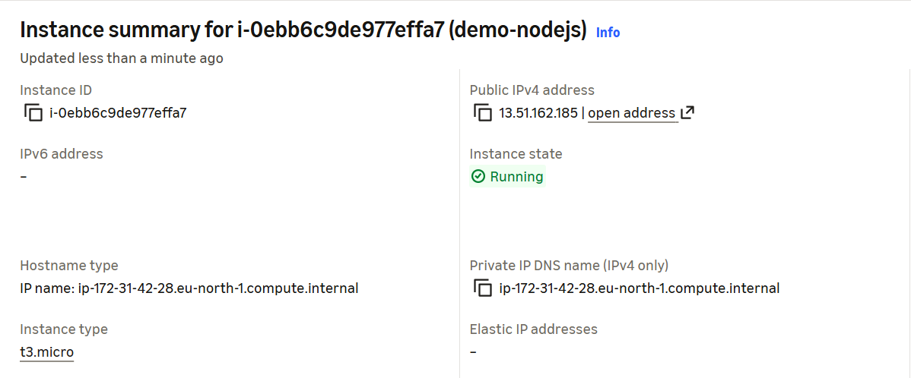
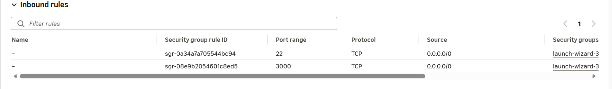
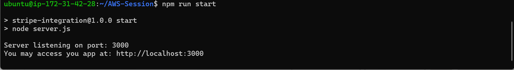
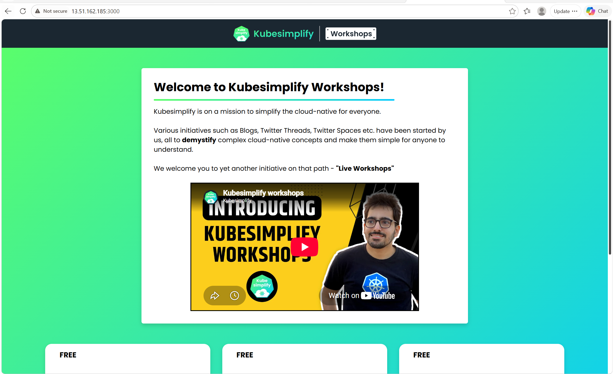

# Node.js App Deployment on AWS EC2

Deployed a Node.js (Express + Stripe) web app on an AWS EC2 Ubuntu server, configured networking with security groups, and made it publicly accessible over the internet.

## Architecture
User (browser) -> Internet -> Security Group (port 3000) -> EC2 t3.micro (Ubuntu 24.04, Node.js) in the default VPC, eu-north-1

## Tech Used
AWS EC2, Security Groups, VPC, IAM, Ubuntu 24.04, Node.js, npm, Git, SSH

## Steps I Followed
1. Created an IAM user instead of using the root account
2. Launched an EC2 t3.micro instance (Ubuntu 24.04) with a key pair
3. Connected over SSH from WSL: ssh -i key.pem ubuntu@<public-ip>
4. Installed Node.js and npm
5. Cloned the app and created a .env file for secrets (never committed)
6. Installed dependencies with npm install and started the app with npm run start
7. Added an inbound rule for TCP port 3000 in the security group
8. Opened http://<public-ip>:3000 in the browser

## Screenshots
**EC2 instance running**

**Security group inbound rules**

**App running on the server**

**App live on the public IP**

## Problems I Hit and How I Fixed Them
- **App not loading in the browser:** port 3000 was blocked. Fixed by adding a TCP 3000 inbound rule to the security group.
- **localhost vs public IP:** the app said localhost:3000, which only works on the server itself. From outside I used the EC2 public IP.
- **GitHub blocked my push:** push protection found a hard-coded Stripe test secret key in the Dockerfile in the original commit history. I removed the hard-coded keys and started a clean Git history, so no secrets are published. Secrets now live only in .env.

## Improvements I Would Make
- Restrict SSH (port 22) to my IP only instead of 0.0.0.0/0
- Put Nginx in front as a reverse proxy on port 80
- Add HTTPS with a free Let's Encrypt certificate
- Use PM2 so the app keeps running after I close SSH or the server restarts
- Automate deployment with a CI/CD pipeline (GitHub Actions)
- Store secrets in AWS Secrets Manager instead of a .env file

## Credit
App code by Kunal Verma (github.com/verma-kunal/AWS-Session). The deployment, troubleshooting and documentation are my own work.
